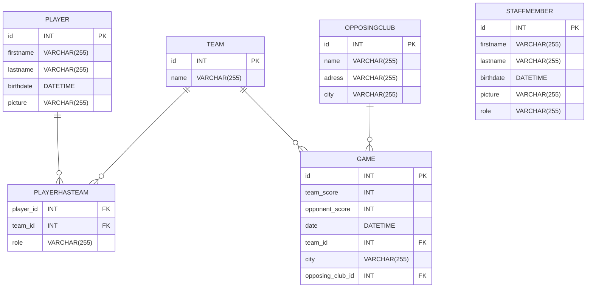

# EsportClub-Project
Site de gestion d'un club d'E-sport, de ses joueurs, des équipes et des matchs.

---
Schéma relationnel de la base de données et du projet :

## Chargement automatique des classes

Les classes PHP sont chargées par `src/autoloader.php`. Le préfixe `src\` correspond au dossier `src/`, puis les namespaces suivent les sous-dossiers : par exemple, `src\classes\Game` se trouve dans `src/classes/Game.php` et `src\controllers\GameDatabase` dans `src/controllers/GameDatabase.php`.

Le point d'entrée `public/index.php` charge déjà l'autoloader. Pour un autre script PHP, incluez-le une fois au début du script, puis utilisez les classes avec leur namespace (ou une instruction `use`). Évitez les `require` individuels pour les classes de l'application.

## Lancer le site

Le site utilise la base SQLite `private/EsportsClub.db`. Depuis la racine du projet, démarrez le serveur PHP avec `php -S localhost:8000 -t public`, puis ouvrez `http://localhost:8000`. PHP doit inclure les extensions PDO et SQLite.

Au premier chargement, l'application ajoute les colonnes `role` aux associations joueur-équipe, `city` aux matchs, ainsi que `birthdate` et `picture` au staff si elles manquent. Ces migrations conservent les enregistrements existants ; les membres du staff déjà présents sans date de naissance sont signalés comme non renseignés jusqu'à leur modification. Les photos de joueurs et du staff sont facultatives et enregistrées comme URL HTTP(S). Pour utiliser une autre base SQLite, définissez la variable d'environnement `ESPORTCLUB_DB_PATH`.

Le tableau de bord affiche les matchs, joueurs et leurs rôles dans les équipes, équipes, membres du staff et clubs opposants. Le bouton « Ajouter » ouvre le panneau d'administration pour créer ces entrées, associer un joueur à une équipe ou enregistrer un match.
