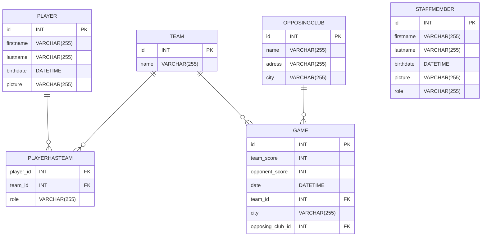

# EsportClub-Project
Site de gestion d'un club d'E-sport, de ses joueurs, des équipes et des matchs.

---
Schéma relationnel de la base de données et du projet :

## Chargement automatique des classes

Les classes PHP sont chargées par `src/autoloader.php`. Le préfixe `src\` correspond au dossier `src/`, puis les namespaces suivent les sous-dossiers : par exemple, `src\classes\Game` se trouve dans `src/classes/Game.php` et `src\controllers\GameDatabase` dans `src/controllers/GameDatabase.php`.

Le point d'entrée `public/index.php` charge déjà l'autoloader. Pour un autre script PHP, incluez-le une fois au début du script, puis utilisez les classes avec leur namespace (ou une instruction `use`). Évitez les `require` individuels pour les classes de l'application.
