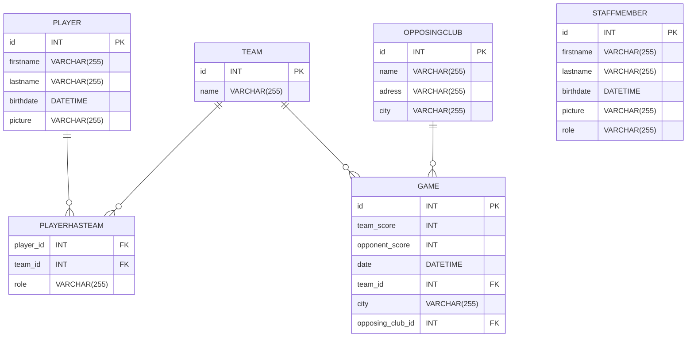

# EsportClub-Project
Site de gestion d'un club d'E-sport, de ses joueurs, des équipes et des matchs.

## Chargement automatique des classes

Les classes PHP sont chargées par `src/autoloader.php`. Le préfixe `src\` correspond au dossier `src/`, puis les namespaces suivent les sous-dossiers : par exemple, `src\classes\Game` se trouve dans `src/classes/Game.php` et `src\controllers\GameDatabase` dans `src/controllers/GameDatabase.php`.

Le point d'entrée `public/index.php` charge déjà l'autoloader. Pour un autre script PHP, incluez-le une fois au début du script, puis utilisez les classes avec leur namespace (ou une instruction `use`). Évitez les `require` individuels pour les classes de l'application.

## Lancer le site

Le site utilise la base SQLite `private/EsportsClub.db`. Depuis la racine du projet, démarrez le serveur PHP avec `php -S localhost:8000 -t public`, puis ouvrez `http://localhost:8000`. PHP doit inclure les extensions PDO et SQLite.

Au premier chargement, l'application ajoute les colonnes `role` aux associations joueur-équipe, `city` aux matchs, ainsi que `birthdate` et `picture` au staff si elles manquent. Ces migrations conservent les enregistrements existants ; les membres du staff déjà présents sans date de naissance sont signalés comme non renseignés jusqu'à leur modification. Les photos de joueurs et du staff sont facultatives et enregistrées comme URL HTTP(S). Pour utiliser une autre base SQLite, définissez la variable d'environnement `ESPORTCLUB_DB_PATH`.

Le tableau de bord affiche les matchs, joueurs et leurs rôles dans les équipes, équipes, membres du staff et clubs opposants. Le bouton « Ajouter » ouvre le panneau d'administration pour créer ces entrées, associer un joueur à une équipe ou enregistrer un match.

## Utilisation
 
1. Le tableau de bord s'affiche à l'ouverture du site.
2. Cliquez sur **Ajouter** pour ouvrir le panneau d'administration.
3. Créez d'abord les entités de base (équipes, joueurs, clubs opposants, staff), puis :
   - associez les joueurs à leurs équipes en précisant leur rôle ;
   - enregistrez les matchs en choisissant l'équipe et le club adverse.
## Structure du projet
 
```
EsportClub-Project/
├── .github/          # Configuration GitHub
├── fixtures/         # Données d'exemple
├── private/          # Base SQLite (EsportsClub.db)
├── public/           # Racine web : index.php et ressources publiques
├── src/
│   ├── classes/      # Entités métier (Game, ...)
│   └── controllers/  # Accès aux données (GameDatabase, ...)
├── .env              # Configuration
├── autoloader.php    # Chargement automatique des classes
├── composer.json
└── composer.lock
```
 
Seul le dossier `public/` est exposé par le serveur web. La base de données dans `private/` n'est donc pas servie directement.
 
## Architecture du code
 
Le code est séparé en deux couches :
 
- **`src/classes/`** : une classe par entité (par exemple `src\classes\Game`).
- **`src/controllers/`** : une classe `*Database` par entité (par exemple `src\controllers\GameDatabase`) qui gère les requêtes SQL via PDO.
### Chargement automatique des classes
 
Les classes sont chargées par l'autoloader. Le préfixe `src\` correspond au dossier `src/`, puis les namespaces suivent les sous-dossiers :
 
| Classe | Fichier |
|---|---|
| `src\classes\Game` | `src/classes/Game.php` |
| `src\controllers\GameDatabase` | `src/controllers/GameDatabase.php` |
 
Le point d'entrée `public/index.php` charge déjà l'autoloader. Pour un autre script PHP, incluez-le une fois au début, puis utilisez les classes avec leur namespace (ou une instruction `use`). Évitez les `require` individuels pour les classes de l'application.
 
## Modèle de données
 

 
| Table | Description |
|---|---|
| `PLAYER` | Joueurs du club |
| `TEAM` | Équipes du club |
| `PLAYERHASTEAM` | Association joueur ↔ équipe, avec le rôle du joueur dans l'équipe |
| `GAME` | Matchs d'une équipe contre un club opposant (scores, date, ville) |
| `OPPOSINGCLUB` | Clubs adverses |
| `STAFFMEMBER` | Membres du staff (indépendants des équipes) |
 
## Migrations automatiques
 
Au premier chargement, l'application ajoute les colonnes manquantes :
 
- `role` sur les associations joueur-équipe ;
- `city` sur les matchs ;
- `birthdate` et `picture` sur le staff.
Ces migrations conservent les enregistrements existants. Les membres du staff déjà présents sans date de naissance sont signalés comme « non renseignés » jusqu'à leur modification.
